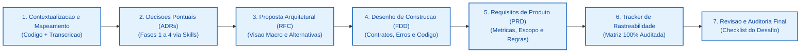

# Order Management System (OMS) — Sistema de Webhooks de Notificação de Pedidos

> **Pacote de Design Docs Gerado com Inteligência Artificial**  
> Desafio Técnico: *Da Reunião ao Documento: Design Docs Gerados por IA*  
> Documento de Enunciado Original: [README_DESAFIO.md](README_DESAFIO.md)

---

## 1. Sobre o Desafio

Este projeto documenta a concepção técnica completa do **Sistema de Webhooks de Notificação de Pedidos (Outbound Order Webhooks)** para o Order Management System (`order-management-api`). O ponto de partida foi uma discussão técnica de aproximadamente 55 minutos entre Tech Lead, Product Manager, Engenheiros e Especialista de Segurança, registrada exclusivamente como texto corrido em [TRANSCRICAO.md](TRANSCRICAO.md), acompanhada de um monólito modular backend funcional em Node.js, TypeScript e MySQL 8.0 via Prisma ORM.

O objetivo do desafio consistiu em atuar como **maestro de Inteligência Artificial**, transformando deliberações orais dispersas e a base de código existente em um pacote corporativo de design docs de padrão sênior, com nível de detalhamento estritamente acionável para o time de desenvolvimento iniciar a implementação. Toda decisão, contrato, risco e requisito foi rigorosamente ancorado no código real ou na transcrição, garantindo rastreabilidade bidirecional e blindagem contra alucinações.

---

## 2. Ferramentas de IA Utilizadas

Durante a execução da engenharia de documentação, foram combinadas ferramentas avançadas de raciocínio, agentes autônomos e skills especializadas:

| Ferramenta / Skill | Papel e Responsabilidade no Processo |
| :--- | :--- |
| **Google Antigravity & Claude 4.6 Opus** | Orquestração central de raciocínio, leitura analítica do repositório, formulação de prompts dirigidos, análise semântica da transcrição e refinamento crítico de texto técnico. |
| **Skill `adr-map`** | Mapeamento estruturado da base de código em 8 módulos lógicos coesos (`WEBHOOKS`, `ORDERS`, `CROSSCUTTING`, etc.), gerando o [mapping.md](docs/adrs/mapping.md). |
| **Skill `adr-identify`** | Análise algorítmica de pontuação de impacto e custo de mudança arquitetural, isolando 6 decisões estruturais mandatória (*must-document*) e descartando detalhes efêmeros. |
| **Skill `adr-generate`** | Redação paralela das decisões arquiteturais no padrão formal MADR (Markdown Any Decision Records) canônico em português. |
| **Skill `adr-link`** | Análise do grafo de dependências entre decisões, resolução de links cruzados bidirecionais e auditoria automatizada de ciclos e links quebrados. |
| **Skills `prd-feature` & `fdd-entrevista` & `hld-entrevista`** | Estruturação de requisitos de produto, diagramas de sequência Mermaid, contratos de interfaces REST e matriz de resiliência e erros. |

---

## 3. Workflow Adotado

Para assegurar consistência conceitual entre os diferentes níveis de abstração (produto, arquitetura, decisão pontual e implementação), o trabalho seguiu a seguinte ordem metodológica:



1. **Ingestão e Contextualização do Código e Transcrição:** Mapeamento minucioso de `src/modules/orders/order.service.ts`, `prisma/schema.prisma` e dos mais de 50 minutos de conversa em `TRANSCRICAO.md` para separar fatos acordados de ideias descartadas.
2. **Ciclo de Vida de ADRs Primeiro (Bottom-Up Arquitetural):** Execução do fluxo de 4 fases de ADRs (`adr-map` $\rightarrow$ `adr-identify` $\rightarrow$ `adr-generate` $\rightarrow$ `adr-link`). As decisões fechadas formaram a espinha dorsal técnica para os documentos subsequentes.
3. **Elaboração da RFC (Request for Comments):** Proposta técnica sintetizada para alinhamento da equipe, focando na visão geral da solução, diagrama sequencial transacional, 3 alternativas discutidas e descartadas com seus respectivos trade-offs, e 3 questões em aberto.
4. **Construção do FDD (Feature Design Document):** Detalhamento exaustivo do "como construir", contendo os 5 contratos públicos completos com payloads de entrada e saída, matriz de erros com prefixo `WEBHOOK_`, políticas de resiliência e os 6 ganchos cirúrgicos com arquivos reais do código base.
5. **Consolidação do PRD (Product Requirements Document):** Síntese estratégica em nível de negócio e produto contendo métricas quantitativas de sucesso (latência p95 < 10s, redução de 80% em polling e 100% de retenção de clientes), escopo positivo e negativo detalhado e 11 requisitos funcionais.
6. **Matriz de Rastreabilidade Transversal (`TRACKER.md`):** Mapeamento sistemático de 60 itens ligando requisitos e decisões a timestamps exatos de falas em `TRANSCRICAO.md` (80% da matriz) e caminhos reais de arquivos em `CODIGO` (20% da matriz).
7. **Auditoria Crítica e Produção do README Final:** Verificação item a item da régua de critérios de aceite do desafio técnico.

---

## 4. Prompts Customizados

A qualidade dos documentos resultou da formulação de prompts diretivos, estruturados e informados por contexto. Abaixo destacam-se dois dos prompts essenciais desenvolvidos e utilizados no processo:

### Prompt 1: Extração e Filtragem Crítica de Requisitos e Restrições
Utilizado para minerar a transcrição sem contaminar os documentos com ideias que foram descartadas ou adiadas na reunião:

```markdown
Você é uma Tech Lead sênior revisando a transcrição técnica de alinhamento em TRANSCRICAO.md
para o sistema order-management-api.

Analise as falas dos cinco participantes (Larissa, Marcos, Bruno, Diego e Sofia) e classifique
as informações sob as seguintes categorias estritas:

1. DECISÕES FECHADAS: O que foi aprovado por consenso (ex: Outbox no MySQL, polling de 2s,
   HMAC-SHA256 com secret por endpoint, backoff em 5 níveis, DLQ manual para ADMIN).
2. PONTOS DESCARTADOS COM MOTIVAÇÃO: O que foi explicitamente rejeitado e o trade-off que motivou
   o descarte (ex: chamada síncrona no OrderService, mensageria Kafka/RabbitMQ/Redis, triggers no MySQL).
3. PONTOS ADIADOS / FORA DE ESCOPO: O que foi deixado expressamente para fases futuras (ex: alertas
   por e-mail, rate limiting ativo no worker, frontend gráfico de gestão).
4. QUESTÕES EM ABERTO: O que gerou dúvida técnica e necessita de acompanhamento operacional.

Regras obrigatórias:
- Não invente requisitos inexistentes.
- Cada item extraído deve conter a citação do falante e o minuto aproximado [hh:mm].
- Mantenha a distinção nítida entre o que entra na versão 1.0 e o que fica de fora.
```

### Prompt 2: Mapeamento de Integração com o Código Base para o FDD
Utilizado para assegurar que a seção "Integração com o sistema existente" do FDD não fosse teórica, mas sim conectada aos arquivos reais do projeto:

```markdown
Você é o Arquiteto de Software do Order Management System. Examine os seguintes arquivos reais:
- src/modules/orders/order.service.ts
- src/modules/orders/order.status.ts
- src/shared/errors/app-error.ts
- src/middlewares/auth.middleware.ts
- src/middlewares/error.middleware.ts
- src/shared/logger/index.ts
- prisma/schema.prisma

Descreva cirurgicamente como a nova feature de Webhooks de Notificação de Pedidos irá se acoplar
a cada um desses arquivos, respondendo especificamente:

1. Em order.service.ts, em qual linha e bloco exato a função publishWebhookEvent deve ser inserida?
   Como o PrismaClient transacional (tx) garante rollback atômico se a outbox falhar?
2. Como o enum OrderStatus de order.status.ts será reutilizado nos esquemas Zod de eventos?
3. Como as novas classes de erro de webhooks (com prefixo WEBHOOK_) herdarão de AppError e serão
   formatadas pelo error.middleware.ts existente sem alterar código legado?
4. Como o middleware requireRole('ADMIN') de auth.middleware.ts protegerá a rota de replay de DLQ?
5. Como o logger Pino mascarará as secrets e tokens gerados pelo worker?

Seja extremamente concreto: cite assinaturas de métodos, status HTTP e tipos de dados.
```

---

## 5. Iterações e Ajustes

Durante a produção, a postura crítica de condução da IA foi fundamental para detectar e corrigir desvios, inconsistências lógicas e superficialidades. Foram realizados **4 ciclos principais de iteração e refinamento**:

### Ajuste 1: Correção Estrutural do Diagrama de Transação em Mermaid (RFC)
* **Problema Identificado:** Na primeira geração do diagrama da RFC, a IA desenhou as operações dentro do bloco de transação com setas em paralelo (`TX --> OP1`, `TX --> OP2`, etc.). Isso sugeria erroneamente que a baixa de estoque, atualização do pedido e inserção da outbox ocorriam de forma assíncrona ou concorrente. Além disso, a sintaxe de subgrafo utilizava tokens que disparavam erro de parsing (`CYLINDERSTART`).
* **Intervenção:** Refatorei o Mermaid para refletir a ordem cronológica estrita da transação em `src/modules/orders/order.service.ts`: validação de estoque $\rightarrow$ atualização do pedido $\rightarrow$ inserção de histórico $\rightarrow$ gravação na outbox $\rightarrow$ commit. Subgrafos foram ajustados para nós padrão e o erro de parsing foi eliminado.

### Ajuste 2: Eliminação de Alucinações de Escopo e Filtro de Requisitos (PRD)
* **Problema Identificado:** Em uma das primeiras versões do PRD, a IA sugeriu a inclusão de "notificações por e-mail para falhas graves" e um "mecanismo algorítmico de Token Bucket para rate limiting de saída" como requisitos funcionais da entrega inicial.
* **Intervenção:** Confrontei a saída com a fala explícita de Larissa em `[09:37]` e `[09:39]`. Removi esses pontos dos requisitos funcionais e os reposicionei categoricamente na seção "Fora de Escopo" e na seção de "Questões em Aberto" da RFC, documentando os motivos do adiamento.

### Ajuste 3: Padronização Corporativa de Códigos de Erro e Tipagem Estrita (FDD)
* **Problema Identificado:** O catálogo inicial de erros do FDD apresentava identificadores genéricos em inglês (como `INVALID_URL` ou `INTERNAL_ERROR`), em desacordo com as convenções da base de código do OMS.
* **Intervenção:** Forcei a padronização estrita de todos os códigos de domínio com o prefixo `WEBHOOK_` (`WEBHOOK_INVALID_URL`, `WEBHOOK_CUSTOMER_NOT_FOUND`, `WEBHOOK_PAYLOAD_TOO_LARGE`, `WEBHOOK_DLQ_NOT_FOUND`, `WEBHOOK_DLQ_ALREADY_REPROCESSED`), integrando-os diretamente à árvore de herança de `AppError` e mapeando cada status HTTP correspondente.

### Ajuste 4: Correção de Nomes de Arquivos e Resolução de Links Bidirecionais de ADRs
* **Problema Identificado:** Na compilação inicial da RFC, os links apontavam para nomes provisórios de arquivos de ADRs que divergiam dos arquivos normalizados gerados pelo skill de MADR.
* **Intervenção:** Padronizei os 6 ADRs no formato canônico kebab-case (`ADR-001-padrao-outbox-no-mysql.md` a `ADR-006-reuso-padroes-arquiteturais-existentes.md`), corrigi os caminhos relativos em todos os documentos e rodei o agente `adr-link`, validando 14 links bidirecionais sem ciclos ou quebras.

---

## 6. Como Navegar a Entrega

A documentação foi estruturada para leitura progressiva, permitindo ao leitor transitar suavemente desde a visão estratégica de negócio até a especificação de código e auditoria:

```
docs/
├── PRD.md                 # 1. Por que e o que? Requisitos de produto, personas e metricas
├── RFC.md                 # 2. Como propor? Arquitetura macro, trade-offs e questoes abertas
├── HLD.md                 # 3. Visao de Sistema (Não obrigatório): Topologia, componentes e fluxo de dados
├── FDD.md                 # 4. Como construir? Contratos REST, matriz de erros e codigo
├── TRACKER.md             # 5. De onde veio? Diario de bordo e rastreabilidade cruzada
└── adrs/                  # 6. Por que exatamente assim? Registros formais de decisao (MADR)
    ├── mapping.md         # Mapeamento arquitetural dos modulos da aplicacao
    ├── ADR-001-padrao-outbox-no-mysql.md
    ├── ADR-002-worker-separado-em-polling.md
    ├── ADR-003-politica-retry-backoff-dlq.md
    ├── ADR-004-autenticacao-hmac-sha256-secret-por-endpoint.md
    ├── ADR-005-garantia-at-least-once-idempotencia.md
    └── ADR-006-reuso-padroes-arquiteturais-existentes.md
```

### Ordem Recomendada de Leitura:
1. [docs/PRD.md](docs/PRD.md): Compreenda a dor dos clientes corporativos (Atlas, Max Distribuição, Nova Cargo), os objetivos quantitativos e o escopo aprovado.
2. [docs/RFC.md](docs/RFC.md): Analise a proposta técnica submetida à equipe, as 3 alternativas descartadas e as questões abertas para discussão.
3. [docs/HLD.md](docs/HLD.md): (Não obrigatório) Visualize a topologia geral da solução, componentes e fluxos de dados do monólito modular.
4. [docs/FDD.md](docs/FDD.md): Examine a especificação executável: os 5 contratos públicos, códigos `WEBHOOK_*` e os 6 ganchos de integração com a base de código existente.
5. [docs/adrs/](docs/adrs/): Consulte as 6 decisões arquiteturais canônicas em padrão MADR com alternativas consideradas, prós/contras e links bidirecionais.
6. [docs/TRACKER.md](docs/TRACKER.md): Confira a matriz de rastreabilidade comprovando a origem de 60 itens em `TRANSCRICAO.md` e em `CODIGO`.
