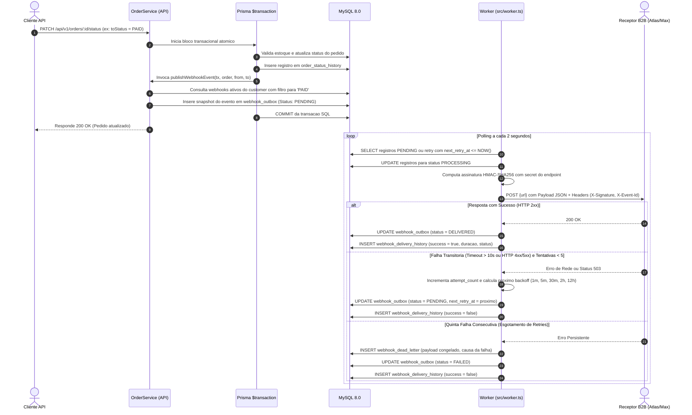

# FDD — Feature Design Document: Sistema de Webhooks de Notificação de Pedidos

* **Versão:** 1.0.0
* **Data:** 2026-10-26
* **Status:** Aguardando Aprovação (Dependente da aprovação da [RFC Proposta Técnica](RFC.md))
* **Responsáveis Técnicos:** Larissa (Tech Lead), Diego (Engenheiro Sênior de Plataforma), Bruno (Engenheiro Pleno)
* **Revisão de Segurança:** Sofia (Engenheira de Segurança)
* **Sistema:** `order-management-api` (Order Management System — OMS REST API)
* **Documentos de Referência:** [PRD da Feature](PRD.md), [RFC Proposta Técnica](RFC.md), [HLD de Arquitetura](HLD.md)

---

## 1. Contexto e Motivação Técnica

O Order Management System (OMS) opera como uma aplicação backend corporativa modular em Node.js com TypeScript, MySQL 8.0 e Prisma ORM. O sistema gerencia clientes, usuários, catálogo de produtos e pedidos através de uma máquina de estados estrita (`src/modules/orders/order.status.ts`), com controle transacional de estoque e histórico auditável de mutações.

Atualmente, o OMS não dispõe de qualquer infraestrutura de mensageria assíncrona ou eventos de saída. Clientes corporativos B2B (com destaque para Atlas Comercial, Max Distribuição e Nova Cargo) realizam consultas contínuas e concorrentes no endpoint de leitura `GET /orders` para detectar alterações no ciclo de vida de seus pedidos. Essa prática de polling excessivo degrada o desempenho do banco relacional, gera contenção de conexões e impõe atrasos na esteira operacional dos clientes.

A feature de Webhooks de Notificação de Pedidos introduz uma arquitetura desacoplada fundamentada no padrão **Transactional Outbox**. Ela garante a emissão confiável e atômica de eventos no instante exato em que a mudança de status do pedido é confirmada no MySQL, delegando o processamento, assinatura e envio das notificações a um processo worker dedicado em segundo plano, protegido por criptografia **HMAC-SHA256**.

### 1.1. Componentes da Base de Código Impactados
* `src/modules/orders/order.service.ts`: Extensão do método `changeStatus` para incluir a gravação atômica na outbox dentro do bloco `prisma.$transaction`.
* `src/modules/webhooks/`: Novo módulo modular contendo `webhooks.controller.ts`, `webhooks.service.ts`, `webhooks.repository.ts`, `webhooks.routes.ts` e `webhooks.schemas.ts`.
* `src/worker.ts`: Novo ponto de entrada do processo consumidor em background (executado via `npm run worker`).
* `prisma/schema.prisma`: Inclusão dos novos modelos relacionais (`WebhookEndpoint`, `WebhookOutbox`, `WebhookDeliveryHistory`, `WebhookDeadLetter`).
* `src/app.ts` e `src/routes/index.ts`: Montagem e injeção de dependências dos novos roteadores em `/api/v1/webhooks` e `/admin/webhooks`.

---

## 2. Objetivos Técnicos

| Objetivo Técnico | Critério de Verificação e Evidência |
| :--- | :--- |
| **Consistência Atômica na Emissão** | Teste de integração automatizado forçando falha deliberada no estoque ou histórico de pedidos, comprovando o rollback integral sem inserção residual de registros na tabela `webhook_outbox`. |
| **Latência Fim a Fim Inferior a 10s** | Medição da diferença temporal entre o `created_at` na outbox e o carimbo de confirmação HTTP 2xx do receptor, garantindo p95 < 10s (média operacional entre 2s e 4s). |
| **Blindagem Criptográfica HMAC-SHA256** | Validação no receptor de teste recalculando a assinatura do cabeçalho `X-Signature` via chave secreta de 32 bytes exclusiva do endpoint. |
| **Resiliência com Backoff Exponencial** | Simulação de indisponibilidade externa com validação dos 5 agendamentos subsequentes: +1m, +5m, +30m, +2h, +12h. |
| **Isolamento em Dead Letter Queue (DLQ)** | Confirmação da migração do registro para a tabela `webhook_dead_letter` após a quinta falha consecutiva de envio. |
| **Segregação de Privilégios no Replay de DLQ** | Rejeição imediata com HTTP 403 Forbidden para requisições de operadores (`OPERATOR`) e autorização com log estruturado de auditoria para administradores (`ADMIN`). |

---

## 3. Escopo e Exclusões

### 3.1. Escopo Incluso
* Modelagem DDL via Prisma dos modelos `WebhookEndpoint`, `WebhookOutbox`, `WebhookDeliveryHistory` e `WebhookDeadLetter`.
* Função transacional pura `publishWebhookEvent` acoplada ao bloco `prisma.$transaction` no método `OrderService.changeStatus`.
* Snapshot congelado do payload do evento serializado em JSON no ato da transição (teto máximo de 64 KB).
* Processo worker desacoplado (`src/worker.ts`, script `npm run worker`) com ciclo de polling a cada 2 segundos.
* Assinatura digital HMAC-SHA256 no cabeçalho `X-Signature` com chave secreta individual por endpoint.
* Endpoint de rotação de chaves com período de convivência (*grace period*) de 24 horas (`previous_secret` e `expires_at`).
* Cabeçalhos padronizados de entrega: `X-Signature`, `X-Event-Id` (UUID v4), `X-Timestamp` (ISO 8601) e `X-Webhook-Id`.
* Máquina de retentativas em 5 etapas escalonadas e timeout de 10 segundos por chamada HTTP via `AbortController`.
* Tabela de Dead Letter Queue para retenção de falhas permanentes e endpoint administrativo de replay restrito a `ADMIN`.
* Endpoints REST para CRUD de webhooks e histórico paginado de entregas.

### 3.2. Exclusões (Fora de Escopo)
* Notificações de alerta via e-mail para falhas sucessivas de webhooks.
* Implementação de limitador ativo de vazão (*outbound rate limiting*) por cliente.
* Dashboard ou painel gráfico de visualização no frontend web.
* Escalonamento horizontal concorrente com coordenação distribuída (arquitetura inicial estritamente *single-worker*).
* Webhooks de entrada (*inbound webhooks*) disparados por terceiros para o OMS.

---

## 4. Fluxos Detalhados da Solução



### 4.1. Passo a Passo do Ciclo de Vida
1. **Gatilho de Negócio:** Requisição `PATCH /api/v1/orders/:id/status` recebida pelo `OrderController`.
2. **Execução Transacional:** `OrderService.changeStatus` abre a transação `this.prisma.$transaction`.
3. **Validação e Mutação:** Valida a máquina de estados, ajusta estoque e atualiza `orders`.
4. **Gravação de Auditoria:** Persiste o histórico em `order_status_history`.
5. **Enfileiramento Outbox:** Invoca `publishWebhookEvent(tx, refreshedOrder, from, to)`. Se o cliente tiver webhook ativo para o status de destino, serializa o payload JSON (<= 64 KB) e grava em `webhook_outbox` com status `PENDING`.
6. **Commit e Liberação:** O banco confirma o commit relacional e a API responde HTTP 200 OK.
7. **Polling do Worker:** O processo `src/worker.ts` desperta a cada 2 segundos, seleciona os registros `PENDING` e os marca como `PROCESSING`.
8. **Cálculo Criptográfico:** O worker recupera a secret ativa do endpoint e computa o hash HMAC-SHA256 sobre o corpo serializado.
9. **Despacho HTTP Outbound:** Dispara `POST {url}` com timeout de 10s e cabeçalhos `X-Signature`, `X-Event-Id`, `X-Timestamp` e `X-Webhook-Id`.
10. **Confirmação ou Retentativa:**
    * **Sucesso (HTTP 2xx):** Marca `DELIVERED` e grava em `webhook_delivery_history`.
    * **Falha (< 5 tentativas):** Incrementa tentativas, calcula o próximo intervalo exponencial (1m, 5m, 30m, 2h, 12h), atualiza `next_retry_at` e retorna status para `PENDING`.
    * **Falha Definitiva (5ª tentativa):** Move os dados para `webhook_dead_letter`, marca `FAILED` na outbox e emite alerta estruturado de log.

---

## 5. Contratos Públicos da Feature

### 5.1. Contrato 1: Cadastro de Webhook (`POST /api/v1/webhooks`)
* **Método e Rota:** `POST /api/v1/webhooks`
* **Autenticação:** Bearer JWT obrigatório (`authenticate`)
* **Perfil Requerido:** `ADMIN` ou `OPERATOR`

**Payload de Entrada (Request Body):**
```json
{
  "customerId": "550e8400-e29b-41d4-a716-446655440000",
  "url": "https://api.atlascomercial.com.br/integracoes/pedidos",
  "events": ["PAID", "PROCESSING", "SHIPPED", "DELIVERED", "CANCELLED"],
  "description": "Endpoint de integracao ERP Atlas"
}
```

**Payload de Resposta (HTTP 201 Created):**
```json
{
  "id": "7c9e6679-7425-40de-944b-e07fc1f90ae7",
  "customerId": "550e8400-e29b-41d4-a716-446655440000",
  "url": "https://api.atlascomercial.com.br/integracoes/pedidos",
  "events": ["PAID", "PROCESSING", "SHIPPED", "DELIVERED", "CANCELLED"],
  "secret": "whsec_9a8f3b4c1e2d5e6f7a8b9c0d1e2f3a4b5c6d7e8f9a0b1c2d3e4f5a6b7c8d9e0f",
  "isActive": true,
  "createdAt": "2026-10-26T22:00:00.000Z"
}
```

### 5.2. Contrato 2: Listagem de Webhooks (`GET /api/v1/webhooks`)
* **Método e Rota:** `GET /api/v1/webhooks?customerId=:customerId&page=1&pageSize=20`
* **Autenticação:** Bearer JWT obrigatório (`authenticate`)

**Payload de Resposta (HTTP 200 OK):**
```json
{
  "data": [
    {
      "id": "7c9e6679-7425-40de-944b-e07fc1f90ae7",
      "customerId": "550e8400-e29b-41d4-a716-446655440000",
      "url": "https://api.atlascomercial.com.br/integracoes/pedidos",
      "events": ["PAID", "PROCESSING", "SHIPPED", "DELIVERED"],
      "isActive": true,
      "createdAt": "2026-10-26T22:00:00.000Z",
      "updatedAt": "2026-10-26T22:00:00.000Z"
    }
  ],
  "pagination": {
    "page": 1,
    "pageSize": 20,
    "total": 1,
    "totalPages": 1
  }
}
```

### 5.3. Contrato 3: Rotação Criptográfica de Segredo (`POST /api/v1/webhooks/:id/rotate-secret`)
* **Método e Rota:** `POST /api/v1/webhooks/:id/rotate-secret`
* **Autenticação:** Bearer JWT obrigatório (`authenticate`)

**Payload de Resposta (HTTP 200 OK):**
```json
{
  "id": "7c9e6679-7425-40de-944b-e07fc1f90ae7",
  "newSecret": "whsec_ff00112233445566778899aabbccddeeff00112233445566778899aabbccddee",
  "previousSecretExpiresAt": "2026-10-27T22:00:00.000Z",
  "message": "Nova chave secreta gerada. A chave anterior permanecera valida para validacao por 24 horas."
}
```

### 5.4. Contrato 4: Replay Manual de DLQ (`POST /admin/webhooks/dead-letter/:id/replay`)
* **Método e Rota:** `POST /admin/webhooks/dead-letter/:id/replay`
* **Autenticação:** Bearer JWT com cargo de Administrador (`authenticate`, `requireRole('ADMIN')`)

**Payload de Resposta (HTTP 200 OK):**
```json
{
  "message": "Evento reprocessado com sucesso e reenfileirado na outbox",
  "deadLetterId": "1a2b3c4d-5e6f-7a8b-9c0d-1e2f3a4b5c6d",
  "newOutboxId": "8f7e6d5c-4b3a-2a1f-0e9d-8c7b6a5f4e3d",
  "replayedAt": "2026-10-26T22:30:00.000Z"
}
```

### 5.5. Contrato 5: Despacho Outbound para Endpoint do Cliente (`POST {url_do_cliente}`)
* **Protocolo:** HTTPS obrigatório
* **Cabeçalhos Mandatórios Enviados:**
  * `Content-Type`: `application/json`
  * `X-Signature`: `sha256={hash_hmac_sha256_do_payload}`
  * `X-Event-Id`: `{uuid_v4_unico_do_evento}`
  * `X-Timestamp`: `{timestamp_iso8601_do_disparo}`
  * `X-Webhook-Id`: `{uuid_do_cadastro_do_webhook}`

**Payload JSON Transmitido:**
```json
{
  "eventId": "e3b0c442-98fc-1c14-9afb-4c8996fb9242",
  "eventType": "order.status_changed",
  "timestamp": "2026-10-26T22:05:00.000Z",
  "data": {
    "orderId": "b1c2d3e4-f5a6-4b7c-8d9e-0f1a2b3c4d5e",
    "orderNumber": "ORD-000123",
    "customerId": "550e8400-e29b-41d4-a716-446655440000",
    "fromStatus": "PENDING",
    "toStatus": "PAID",
    "totalCents": 15990,
    "discountCents": 0,
    "createdAt": "2026-10-26T22:00:00.000Z",
    "updatedAt": "2026-10-26T22:05:00.000Z"
  }
}
```

---

## 6. Matriz de Erros Previstos e Políticas de Resiliência

### 6.1. Matriz de Erros no Padrão `WEBHOOK_*`

| Código de Erro | HTTP Status | Causa Raiz | Política de Retry | Fallback / Tratamento |
| :--- | :--- | :--- | :--- | :--- |
| `WEBHOOK_NOT_FOUND` | 404 | Identificador de webhook inexistente | Não | Retorno formatado via envelope `AppError` |
| `WEBHOOK_CUSTOMER_NOT_FOUND` | 404 | `customerId` inexistente no banco de dados | Não | Retorno formatado via envelope `AppError` |
| `WEBHOOK_INVALID_URL` | 400 | URL informada com protocolo `http://` ou sintaxe malformada | Não | Rejeição fail-fast via esquema Zod |
| `WEBHOOK_PAYLOAD_TOO_LARGE` | 422 | Snapshot serializado excedeu o teto de 64 KB | Não | Abortamento transacional com rollback seguro |
| `WEBHOOK_DLQ_NOT_FOUND` | 404 | Registro de DLQ inexistente para reprocessamento | Não | Retorno de erro administrativo |
| `WEBHOOK_DLQ_ALREADY_REPROCESSED` | 409 | Registro de DLQ já reenfileirado anteriormente | Não | Rejeição com status de conflito |
| `WEBHOOK_DELIVERY_TIMEOUT` | — | Receptor externo não respondeu dentro de 10s | Sim (5 etapas) | Agendamento de retentativa; DLQ na 5ª falha |
| `WEBHOOK_DELIVERY_FAILED` | — | Conexão recusada ou retorno HTTP 4xx/5xx | Sim (5 etapas) | Agendamento de retentativa; DLQ na 5ª falha |

### 6.2. Configuração de Timeouts e Idempotência
* **Timeout na API REST:** Timeout de 30 segundos gerenciado pelo Express (p95 alvo < 150 ms).
* **Timeout Outbound no Worker:** Timeout rígido de 10 segundos implementado via `AbortController` nativo do Node.js.
* **Garantia At-Least-Once com Idempotência:** O identificador UUID v4 enviado em `X-Event-Id` é imutável em todas as retentativas daquele evento. O cliente corporativo deve utilizar este UUID como chave primária de desduplicação em seu banco de dados para evitar reprocessamento de ações comerciais.

---

## 7. Observabilidade (Métricas, Logs e Tracing)

### 7.1. Logging Estruturado (Pino)
* Todos os eventos operacionais utilizam a instância compartilhada do Pino Logger (`src/shared/logger/index.ts`).
* Sanitização ativa com redatores para omitir cabeçalhos `Authorization`, `Cookie`, campos `password`, `secret` e `previous_secret`.
* Campos obrigatórios em cada log de despacho:
  * `requestId`: Identificador único de rastreamento da requisição original (`X-Request-Id`).
  * `eventId`: UUID do evento na tabela outbox.
  * `webhookId`: UUID do endpoint de destino.
  * `customerId`: UUID do cliente proprietário do pedido.
  * `attemptCount`: Número da tentativa em execução (1 a 5).
  * `durationMs`: Duração da chamada HTTP outbound em milissegundos.
  * `httpStatus`: Código de resposta retornado pelo receptor ou código de erro de rede.

### 7.2. Métricas Operacionais
* **Medidores (Gauges):**
  * `webhook_outbox_pending_gauge`: Contagem instantânea de registros com status `PENDING` na outbox.
  * `webhook_outbox_processing_gauge`: Contagem instantânea de registros com status `PROCESSING`.
* **Contadores (Counters):**
  * `webhook_deliveries_total`: Contagem total de requisições despachadas, etiquetadas por `status="success"` ou `status="failure"`.
  * `webhook_dead_letter_total`: Contagem cumulativa de eventos transferidos para a DLQ.
* **Histogramas (Histograms):**
  * `webhook_delivery_duration_seconds`: Distribuição de latência das requisições outbound.

### 7.3. Tracing Contextual
* Propagação transparente do cabeçalho `X-Event-Id` entre a gravação na outbox e o envio HTTP.
* Preservação do `X-Request-Id` recebido na API REST até a emissão dos logs operacionais do worker.

---

## 8. Dependências e Compatibilidade de Ambiente

| Componente | Versão Mínima Homologada | Papel no Módulo de Webhooks |
| :--- | :--- | :--- |
| **Node.js** | `>= 20.0.0` (ESM Nativo) | Runtime de execução da API e do processo do worker (`src/worker.ts`), utilizando `fetch` nativo e `AbortController`. |
| **TypeScript** | `5.6.0` (Strict Mode) | Tipagem estrita de contratos de domínio, repositórios e serviços. |
| **Express** | `4.21.0` | Framework HTTP para roteamento dos novos endpoints REST. |
| **Prisma ORM** | `5.22.0` | Gestão de esquemas DDL e execução do bloco atômico `prisma.$transaction`. |
| **MySQL** | `8.0` | Armazenamento relacional com suporte a transações ACID e índices compostos. |
| **Zod** | `3.23.0` | Validação estrita de esquemas de entrada com coerção e parsing HTTPS. |
| **Pino / Pino-HTTP** | `9.5.0` / `10.3.0` | Logger de alta performance com sanitização nativa de dados sensíveis. |

---

## 9. Integração com o Sistema Existente

A implementação da feature acopla-se de maneira cirúrgica à base de código existente, preservando as convenções e os padrões corporativos em seis pontos de integração reais:

### 1. Extensão Transacional em `src/modules/orders/order.service.ts`
O método `changeStatus(id: string, input: ChangeOrderStatusInput, userId: string)` orquestra a máquina de estados e o inventário sob o bloco atômico `this.prisma.$transaction(async (tx) => { ... })`. A integração dos webhooks acopla a função pura `publishWebhookEvent(tx, refreshedOrder, from, to)` imediatamente após a gravação de `orderStatusHistory` e antes do retorno do pedido. Como a função consome o cliente transacional `tx`, a inserção na outbox compartilha o mesmo escopo ACID. Caso ocorra qualquer erro de escrita na outbox, a transação sofre rollback integral, garantindo que o status do pedido não seja alterado.

### 2. Reuso da Máquina de Estados em `src/modules/orders/order.status.ts`
O módulo de pedidos define os estados válidos através do enum `OrderStatus` e das regras de transição em `canTransition(from, to)`. O módulo de webhooks reutiliza o enum `OrderStatus` diretamente nos esquemas Zod de cadastro (`events: z.array(z.nativeEnum(OrderStatus))`), garantindo que apenas estados homologados no domínio possam ser configurados como filtros de escuta por clientes.

### 3. Herança de Erros Corporativos em `src/shared/errors/app-error.ts` e `src/shared/errors/http-errors.ts`
A plataforma adota uma hierarquia estruturada encabeçada pela classe abstrata `AppError` e especializações como `NotFoundError`, `ConflictError` e `ValidationError`. As exceções de domínio de webhooks herdam diretamente dessa infraestrutura, padronizando os códigos com o prefixo `WEBHOOK_` (como `WebhookNotFoundError extends NotFoundError` e `WebhookInvalidUrlError extends AppError`), garantindo status HTTP e formatação padronizados.

### 4. Controle de Acesso e RBAC em `src/middlewares/auth.middleware.ts`
As rotas de webhooks reaproveitam o middleware stateless `authenticate` para validação de tokens Bearer JWT e injeção do usuário em `req.user`. O endpoint administrativo de replay de DLQ (`POST /admin/webhooks/dead-letter/:id/replay`) é protegido diretamente pela combinação `authenticate` e `requireRole('ADMIN')`, impedindo acessos de operadores comuns sem a necessidade de criar mecanismos redundantes de segurança.

### 5. Tratamento Centralizado de Erros em `src/middlewares/error.middleware.ts`
O interceptador global de erros processa instâncias de `AppError`, `ZodError` e falhas do Prisma, envelopando as respostas no padrão corporativo `{ "error": { "code": "...", "message": "...", "details": [...] } }`. Ao utilizar a hierarquia de `AppError`, os novos erros de webhooks são formatados automaticamente pelo middleware existente sem demandar alterações no handler global.

### 6. Sanitização de Credenciais em `src/shared/logger/index.ts`
A instância do Pino Logger possui redatores configurados para omitir campos confidenciais como `password`, `token` e cabeçalhos de autorização. O módulo de webhooks e o processo do worker consomem essa mesma instância configurada, garantindo que as chaves secretas de assinatura e payloads confidenciais nunca sejam expostos em texto aberto nos logs de auditoria.

---

## 10. Critérios de Aceite Técnicos

* [x] O arquivo `prisma/schema.prisma` contém os 4 modelos relacionais mapeados com tipos e índices correspondentes (`WebhookEndpoint`, `WebhookOutbox`, `WebhookDeliveryHistory`, `WebhookDeadLetter`).
* [x] A tabela `webhook_outbox` é alimentada estritamente dentro da transação do `OrderService.changeStatus`.
* [x] Se a transação SQL de `changeStatus` for revertida por qualquer erro, nenhum registro permanece na `webhook_outbox`.
* [x] O processo `src/worker.ts` inicia via script `npm run worker` e consome eventos pendentes com intervalo de polling de 2 segundos.
* [x] O cabeçalho `X-Signature` é gerado com HMAC-SHA256 válido e verificado com a secret individual do endpoint.
* [x] URLs de webhooks cadastradas que não utilizem protocolo HTTPS são rejeitadas no schema Zod com código `WEBHOOK_INVALID_URL` (HTTP 400).
* [x] Chamadas externas que excedam o timeout de 10 segundos são abortadas via `AbortController`.
* [x] O worker respeita a progressão de 5 retries com backoff exponencial (1m, 5m, 30m, 2h, 12h).
* [x] Eventos que ultrapassam a 5ª tentativa são transferidos para a tabela `webhook_dead_letter`.
* [x] O endpoint `POST /admin/webhooks/dead-letter/:id/replay` retorna 403 Forbidden para usuários com cargo `OPERATOR`.
* [x] A rotação de chaves atualiza a secret ativa e preserva a chave anterior válida por exatamente 24 horas.
* [x] O histórico de entregas em `GET /api/v1/webhooks/:id/deliveries` retorna status HTTP e tempo de resposta paginados.
* [x] Payloads montados cujo tamanho serializado ultrapasse 64 KB são rejeitados antes do despacho.
* [x] A suite de testes de integração executa com sucesso contra o banco MySQL via `npm test`.

---

## 11. Riscos Técnicos e Estratégias de Mitigação

| Risco Técnico Identificado | Nível | Estratégia de Mitigação | Plano de Contingência |
| :--- | :--- | :--- | :--- |
| **Cliente com endpoint inacessível gerando travamento no worker** | Alto | Timeout estrito de 10s via `AbortController`, execução assíncrona de disparos e backoff exponencial com janela ampla (~15h). | Descarte automático para a DLQ na 5ª falha, desimpedindo a outbox e retendo o diagnóstico para intervenção manual. |
| **Concorrência e duplicidade de leitura na outbox** | Médio | Arquitetura inicial restrita a instância única (*single-worker*) e transição imediata de status de `PENDING` para `PROCESSING`. | Header `X-Event-Id` único transmitido em todas as chamadas para permitir desduplicação idempotente no receptor do cliente. |
| **Impacto de I/O no MySQL pelo polling a cada 2s** | Médio | Índice composto cobrindo `(status, next_retry_at, created_at)`, consultas em lotes limitados (20 a 50 registros) e pool de conexões Prisma isolado para o worker. | Ajuste dinâmico do intervalo de polling via variável de ambiente `POLLING_INTERVAL_MS` (ex.: de 2s para 5s) sem necessidade de redeploy. |
