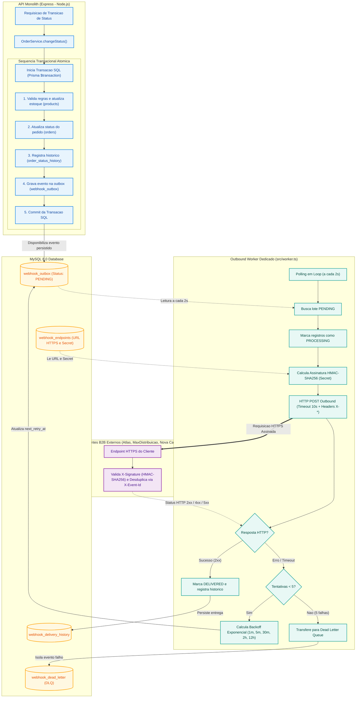

# RFC — Request for Comments: Sistema de Webhooks de Notificação de Pedidos

| Metadado | Detalhe |
| :--- | :--- |
| **RFC** | RFC-001 |
| **Título** | Sistema de Webhooks de Notificação de Pedidos (Outbound Order Webhooks) |
| **Autor(es)** | Larissa (Tech Lead), Diego (Engenheiro Sênior de Plataforma) |
| **Status** | Em Revisão (Under Review) |
| **Data de Criação** | 2026-10-26 |
| **Revisores** | Larissa (Tech Lead), Marcos (Product Manager), Bruno (Engenheiro Pleno), Diego (Engenheiro Sênior), Sofia (Engenheira de Segurança) |
| **Alvo da Entrega** | Fim do Trimestre Vigente (3 Sprints) |

---

## 1. Resumo Executivo (TL;DR)

Esta RFC propõe a arquitetura e o modelo técnico para a implementação do serviço de **Webhooks de Saída (Outbound Webhooks)** no Order Management System (OMS). A proposta tem como meta notificar sistemas externos de clientes B2B (como Atlas Comercial, Max Distribuição e Nova Cargo) em tempo hábil (latência inferior a 10 segundos) sobre alterações no ciclo de vida dos pedidos (`PAID`, `PROCESSING`, `SHIPPED`, `DELIVERED`, `CANCELLED`).

A abordagem sugerida adota o padrão **Transactional Outbox** integrado ao banco relacional MySQL existente, associado a um **Worker assíncrono independente** executando polling a cada 2 segundos. A integridade e autenticidade da comunicação serão asseguradas via assinaturas criptográficas **HMAC-SHA256** com segredos únicos por endpoint e suporte a rotação com período de convivência (*grace period*) de 24 horas. Para falhas temporárias, a solução introduz retentativas com **backoff exponencial** em 5 níveis e descarte seguro em **Dead Letter Queue (DLQ)** persistida, com mecanismo de replay manual restrito a usuários administradores.

---

## 2. Contexto e Motivação

### 2.1. O Cenário Atual
O Order Management System (`order-management-api`) opera como um monólito modular em Node.js com TypeScript, MySQL 8.0 e Prisma ORM. Atualmente, a plataforma não dispõe de nenhum mecanismo de mensageria, eventos ou notificações externas.

Para acompanhar o progresso de seus pedidos, clientes corporativos B2B realizam consultas repetitivas via polling no endpoint `GET /orders`. Esse comportamento gera:
1. **Sobrecarga desnecessária na infraestrutura:** Consultas de leitura concorrentes no MySQL competindo por conexões e buffers de memória com transações de escrita críticas (`OrderService.changeStatus`).
2. **Latência percebida elevada:** Atualizações de status demoram a ser descobertas pelos clientes, dependendo do intervalo de polling que eles configuraram.
3. **Risco comercial iminente:** Clientes estratégicos relatam atrito técnico. A Atlas Comercial formalizou risco de migração para concorrência caso uma solução de integração em tempo real não seja entregue até o encerramento do trimestre.

### 2.2. Metas de Sucesso
* **Latência de Notificação:** Notificação entregue ao endpoint externo em menos de 10 segundos após a confirmação transacional do pedido (com meta operacional média entre 2 e 4 segundos).
* **Alívio de Tráfego:** Redução de no mínimo 80% no volume de requisições de leitura de polling em `GET /orders` realizadas por clientes integrados.
* **Retenção de Contas:** 100% de retenção dos clientes B2B que solicitaram a feature.

---

## 3. Proposta Técnica

Propomos uma arquitetura desacoplada em três camadas funcionais: **Persistência Transacional (Outbox)**, **Processamento e Despacho Assíncrono (Worker)** e **Governança de APIs e Resiliência (Módulo Webhooks)**.

### 3.1. Enfileiramento via Transactional Outbox
Para assegurar total consistência entre a mudança de status do pedido e a emissão do evento, o registro na tabela `webhook_outbox` ocorrerá estritamente dentro da mesma transação SQL gerenciada pelo Prisma no `OrderService.changeStatus`.

* **Snapshot de Payload Congelado:** O corpo do evento será renderizado e persistido como JSON serializado no momento do commit da transação. Isso protege a notificação contra mutações posteriores dos dados do pedido.
* **Filtragem Pró-Ativa:** Apenas pedidos cujo novo status conste na lista de interesses do cliente (`events`) gerarão entradas na outbox, poupando espaço em disco e I/O de escrita.
* **Teto de Carga Útil:** Payloads serão limitados a 64 KB, contendo identificadores e dados agregados de status, sem a inclusão de listas volumosas de itens (clientes que demandarem detalhes consultarão `GET /orders/:id`).

### 3.2. Worker Desacoplado em Processo Separado
O processamento e disparo das requisições externas não ocorrerão dentro do processo web principal da API Express.

* **Isolamento de Processo:** Um processo Node.js dedicado (`src/worker.ts`, disparado via `npm run worker`) operará em paralelo, evitando que lentidões de rede externa afetem o loop de eventos das requisições HTTP de clientes da API.
* **Mecanismo de Polling:** O worker consultará a tabela `webhook_outbox` a cada 2 segundos buscando registros com status `PENDING` ordenados por data de criação (`created_at`).
* **Conexões Independentes:** O worker instanciará um `PrismaClient` próprio, consumindo sua própria cota de pool de conexões do MySQL.

### 3.3. Contrato de Segurança e Assinatura Criptográfica
* **Obrigatoriedade de HTTPS:** Todos os endpoints cadastrados passarão por validação estrita de esquema Zod, recusando URLs HTTP em texto plano.
* **Assinatura HMAC-SHA256:** Cada evento enviado conterá o header `X-Signature` gerado a partir do cálculo de HMAC-SHA256 sobre o corpo serializado utilizando a secret exclusiva daquele webhook.
* **Segredo por Endpoint:** Cada endpoint cadastrado terá sua própria secret criptograficamente aleatória. Não haverá secret compartilhada globalmente.
* **Rotatividade com Carência (Grace Period):** A rotação de chave preservará a secret anterior ativa pelo período de 24 horas (`previous_secret` e `expires_at`), permitindo aos clientes atualizar seus servidores sem interrupção no fluxo.

### 3.4. Resiliência, Retries e Dead Letter Queue (DLQ)
* **Semântica At-Least-Once:** A entrega garante que nenhum evento confirmado em banco seja perdido. Como falhas transitórias podem demandar reenvios, os clientes farão a desduplicação através do identificador único enviado no cabeçalho `X-Event-Id` (UUID).
* **Política de Backoff:** Falhas de conexão, erros 4xx/5xx ou timeouts (acima de 10s) acionam retentativas com intervalos exponenciais:
  * 1ª retentativa: 1 minuto
  * 2ª retentativa: 5 minutos
  * 3ª retentativa: 30 minutos
  * 4ª retentativa: 2 horas
  * 5ª retentativa: 12 horas (janela total de cobertura de aproximadamente 15 horas)
* **Isolamento em DLQ:** Eventos que falharem após 5 tentativas serão transferidos para a tabela `webhook_dead_letter` contendo diagnóstico da falha, código HTTP e payload original.
* **Replay Administrativo:** Eventos retidos na DLQ poderão ser reprocessados manualmente via rota restrita a administradores (`POST /admin/webhooks/dead-letter/:id/replay`), com emissão de logs estruturados de auditoria.

---

## 4. Alternativas Consideradas e Motivos de Descarte

Durante a sessão técnica de alinhamento, três rotas arquiteturais alternativas foram amplamente discutidas e descartadas:

### Alternativa 1: Disparo Síncrono no `OrderService`
* **Descrição:** Realizar a chamada HTTP `fetch` diretamente dentro do fluxo de execução do método `changeStatus` da API.
* **Trade-off / Motivo de Descarte:** Rejeitada categoricamente. A transação de mudança de status já executa tarefas pesadas (atualização de pedidos, inserção de histórico e baixa concorrente de estoque). Adicionar requisições de rede externas no ciclo de vida da transação bloquearia conexões de banco em clientes lentos. Além disso, a indisponibilidade transitória do servidor do cliente forçaria o rollback de operações válidas de negócio no OMS.

### Alternativa 2: Adoção de Mensageria Dedicada Externa (Redis Streams, RabbitMQ ou Kafka)
* **Descrição:** Publicar eventos de mudança de status em um cluster de mensageria externo e utilizar workers dedicados para consumir essas filas.
* **Trade-off / Motivo de Descarte:** Rejeitada por *overengineering* e custo operacional no momento da empresa. Introduzir um novo componente de infraestrutura exigiria monitoramento, clusters redundantes de alta disponibilidade e coordenação de consistência de duas fases (Two-Phase Commit ou Dual-Write) entre o MySQL e o broker de eventos. A tabela de Outbox no MySQL existente supre plenamente o volume e atende aos requisitos de entrega em menos de 10 segundos com menor custo operacional.

### Alternativa 3: Notificação por Triggers Nativas do Banco de Dados
* **Descrição:** Utilizar triggers no MySQL para notificar o processo consumidor no momento exato do commit de alteração de dados.
* **Trade-off / Motivo de Descarte:** Rejeitada por incompatibilidade tecnológica. Diferente do comando `LISTEN/NOTIFY` disponível no PostgreSQL, o MySQL 8.0 não possui listener de eventos externo nativo. A execução de triggers se restringe a rotinas SQL internas, exigindo soluções não padronizadas (como gravação de pipes ou chamadas via UDF) frágeis e desaconselhadas em produção corporativa. O polling de 2 segundos entrega a latência exigida com simplicidade e robustez.

---

## 5. Questões em Aberto (Open Questions para Discussão)

Conforme deliberado na reunião técnica, os seguintes pontos permanecem em aberto ou postergados para decisão subsequente:

1. **Implementação de Rate Limiting de Saída (Outbound Rate Limiting):**
   * *Questão:* Se um cliente tiver um volume repentino de 50 a 100 pedidos atualizados no mesmo minuto, o worker deve limitar a taxa de chamadas por segundo para o endpoint do cliente a fim de não sobrecarregar sua infraestrutura?
   * *Status Atual:* Decidido **observar em produção**. Iremos monitorar a volumetria e a saúde dos servidores dos clientes piloto (Atlas, MaxDistribuição) antes de introduzir um limitador algorítmico (Token Bucket ou Leaky Bucket).
   * *Feedback Solicitado:* Engenharia de Plataforma e Operações recomendam adicionar um teto preventivo por domínio já na primeira entrega?

2. **Canal de Alertas Proativos para Falhas Recorrentes:**
   * *Questão:* Devemos notificar o cliente via e-mail ou Slack quando seu endpoint acumular mais de 3 falhas seguidas ou for encaminhado para a DLQ?
   * *Status Atual:* Considerado **fora de escopo** para as 3 primeiras sprints. O time de produto e atendimento comunicará eventuais incidentes manualmente.
   * *Feedback Solicitado:* A ausência de alerta automatizado de falha pode sobrecarregar o suporte caso o cliente fique desatento a falhas em seu próprio servidor?

3. **Escalonamento Horizontal de Workers e Ordenação Global:**
   * *Questão:* Atualmente, a garantia de ordenação de eventos por pedido é suportada pela existência de uma instância única de worker (`single-worker`). Como proceder no momento em que precisarmos escalar horizontalmente múltiplos processos consumidores?
   * *Status Atual:* Registrado como **limitação conhecida** da primeira fase. Uma futura expansão demandará particionamento determinístico por `order_id` ou locks pessimistas (`SELECT ... FOR UPDATE SKIP LOCKED`).
   * *Feedback Solicitado:* A equipe considera necessário deixar os índices preparados para `SKIP LOCKED` já na modelagem inicial do Prisma?

---

## 6. Impactos Operacionais e Riscos

| Risco Identificado | Nível | Mitigação Proposta |
| :--- | :--- | :--- |
| **Degradação de I/O por Polling no MySQL** | Médio | Criação de índice composto otimizado em `(status, next_retry_at, created_at)` na tabela `webhook_outbox`. Leitura realizada em pequenos lotes com limites controlados. |
| **Vazamento de Segredos de Webhooks em Logs do Cliente** | Alto | Isolamento das secrets por endpoint (o vazamento em um sistema não compromete os demais) e suporte a endpoint de rotação rápida com 24h de tolerância. |
| **Timeout e Bloqueio de Rede no Worker** | Médio | Estabelecimento de limite estrito de timeout de chamada HTTP em 10 segundos, cancelando a conexão e agendando retentativa. |
| **Acúmulo Excessivo na Tabela de Outbox** | Médio | Planejamento de rotina futura de expurgo/arquivamento de eventos com status `DELIVERED` com mais de 30 dias. |
| **Gargalo no Cronograma por Revisão de Segurança** | Médio | Reserva obrigatória de 2 dias úteis dedicados para a engenheira Sofia inspecionar a geração criptográfica, HMAC e as regras de autorização de DLQ antes do deploy. |

---

## 7. Decisões Arquiteturais Relacionadas (ADRs)

A consolidação formal das decisões de arquitetura e design deste sistema é detalhada nos registros individuais correspondentes:

* [ADR-001: Padrão Outbox no MySQL](adrs/ADR-001-padrao-outbox-no-mysql.md) - Formalização do desacoplamento transacional via outbox relacional.
* [ADR-002: Worker Desacoplado em Processo Separado com Polling](adrs/ADR-002-worker-separado-em-polling.md) - Separação da execução de chamadas externas do ciclo de requisições da API.
* [ADR-003: Política de Retry com Backoff Exponencial e Dead Letter Queue](adrs/ADR-003-politica-retry-backoff-dlq.md) - Estratégia de tolerância a falhas temporárias e retenção de erros permanentes.
* [ADR-004: Autenticação Criptográfica HMAC-SHA256 com Secret por Endpoint](adrs/ADR-004-autenticacao-hmac-sha256-secret-por-endpoint.md) - Garantia de autenticidade, integridade e modelo de rotação de segredos.
* [ADR-005: Garantia de Entrega At-Least-Once com Header de Idempotência](adrs/ADR-005-garantia-at-least-once-idempotencia.md) - Definição do contrato de idempotência via cabeçalho `X-Event-Id`.
* [ADR-006: Reuso dos Padrões de Código e Arquitetura Existentes](adrs/ADR-006-reuso-padroes-arquiteturais-existentes.md) - Alinhamento com `AppError`, Logger Pino, Zod e a arquitetura modular da aplicação.

---

## 8. Cronograma e Próximos Passos

A execução do projeto está estimada em **três sprints de desenvolvimento** (6 semanas úteis):
* **Sprint 1:** Modelagem do banco via Prisma (tabelas `webhook_endpoints`, `webhook_outbox`, `webhook_dead_letter` e histórico de entregas); integração transacional com `OrderService.changeStatus`.
* **Sprint 2:** Desenvolvimento do worker desacoplado (`src/worker.ts`), cálculo e validação de assinaturas HMAC-SHA256 e máquina de retentativas com backoff exponencial.
* **Sprint 3:** Implementação dos endpoints REST de gerenciamento de webhooks, rotação de secrets, replay de DLQ restrito a perfil `ADMIN`, testes de integração e testes ponta a ponta.
* **Revisão e Deploy:** Bloqueio de 2 dias úteis dedicados para validação formal de segurança e auditoria por Sofia antes da liberação controlada em produção para os clientes piloto.
